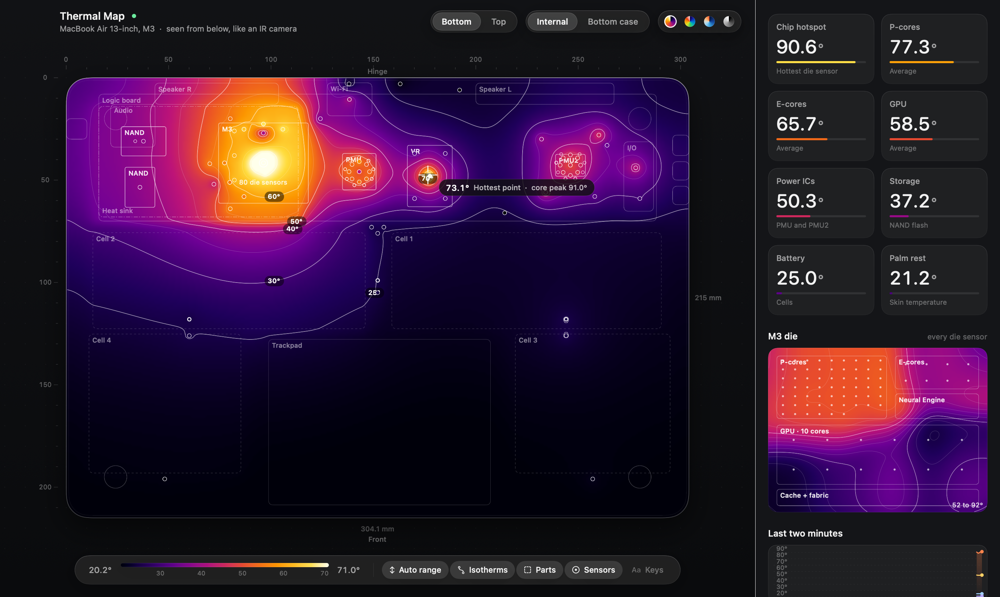
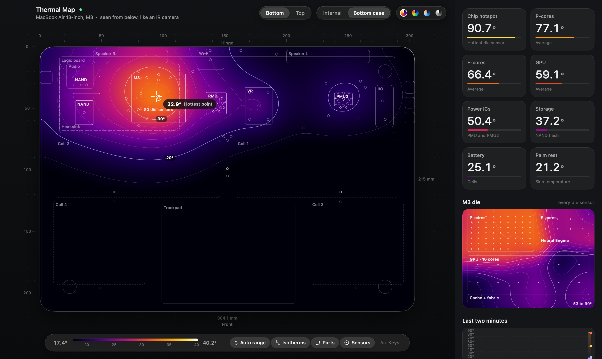

# Thermal Map

Thermal Map shows the heat inside a MacBook Air the way a thermal camera would. It reads all 205 temperature sensors in the 13-inch MacBook Air with M3, places each reading on the part it measures, and solves how heat flows between them. The result is a live, smooth picture of the M3, the heat sink, the logic board and the battery, updated five times a second.

> **Made for one Mac.** Thermal Map, its heat model and its board layout were built specifically to show the heat inside the **13-inch MacBook Air with M3** (Mac15,12). The part outlines, sensor positions and model constants all belong to that machine. It runs on other Apple silicon Macs, but they have a different board, so the map would be wrong there, and the app says so. Layouts for other models are welcome, see [Contributing](#contributing).



Watch the [demo video](https://github.com/Louistuis/thermal-map/releases/download/v1.0/thermal-map-demo-1080p.mp4) (38 seconds, narrated, recorded from live data).

## Features

- **Every sensor.** All 167 SMC temperature keys (CPU and GPU cores, heat sink, power management, regulators, storage, battery, palm rests, Wi-Fi, display) and 38 HID thermal services (PMU and PMU2 die sensors, NAND, battery gas gauge). Keys that never return a usable value are detected and skipped.
- **A heat model, not a blur.** A two-layer heat-conduction model on a 2 mm grid. Each part has its own conductivity: the aluminium heat sink spreads heat well, the logic board less so, the battery and trackpad poorly. Sensors are fixed at the spots they measure and the model fills in the rest, so heat runs along the heat sink and the board instead of spreading in round blobs.
- **Bottom case.** A second modelled layer for the outer aluminium shell. It is coupled to the internals, cooled by room air, and has thermal mass, so it warms and cools more slowly than the parts inside. It is roughly what an IR camera on the underside would see.
- **Bottom and top views.** See the board from underneath, like a thermal camera pointed at the bottom case, or from the keyboard side.
- **Isotherms** traced as smooth vector contours, with labelled levels.
- **M3 die inset** with all 80 on-die sensors across the performance cores, efficiency cores, GPU and Neural Engine.
- **Four palettes,** auto or fixed range.
- **Sensor list** with live, minimum and maximum values for every key. Hover a sensor to find it on the map.
- **Light on the Mac it measures.** About 7% of one CPU core with the window open, about 5% when it is hidden. The map pauses when no window is visible.



## Download

1. Download **Thermal-Map.zip** from the [latest release](https://github.com/Louistuis/thermal-map/releases/latest).
2. Unzip it and move **Thermal Map** to your Applications folder.
3. The app is signed ad hoc and not notarized, because it is not published with a paid Apple Developer ID. The first time, macOS will refuse to open it. Right-click the app, choose **Open**, then choose **Open** again. Or run this once in Terminal:

   ```bash
   xattr -dr com.apple.quarantine "/Applications/Thermal Map.app"
   ```

**Requirements**

- macOS 14 Sonoma or later on Apple silicon.
- The map is built and calibrated for the **13-inch MacBook Air with M3 (Mac15,12)**. On any other Mac the app still reads every sensor and the list is correct, but the map shows this model's board. Layouts for other Macs are the most wanted contribution (see Contributing).
- No admin rights, kernel extensions or helper tools. Thermal Map only reads sensors.

## Setup: build from source

You only need the Xcode Command Line Tools. Full Xcode is not required.

```bash
xcode-select --install
```

```bash
git clone https://github.com/Louistuis/thermal-map.git
cd thermal-map
./build.sh
```

`build.sh` compiles `Sources/*.swift` with `swiftc`, makes the app icon, writes `Info.plist`, signs the app ad hoc and installs it in `/Applications`. To install it somewhere else, set `DEST`:

```bash
DEST="$HOME/Applications" ./build.sh
```

The built app is also left in `build/Thermal Map.app`.

### Headless tools

The same binary has a few modes that never open a window:

```bash
BIN="/Applications/Thermal Map.app/Contents/MacOS/ThermalMap"

"$BIN" --render=out.png [--top] [--surface]          # one image after a few seconds of live data
"$BIN" --record=frames --seconds=60 --fps=2 \
       --at=30:surface [--format=jpg]                # a frame sequence of live data, with timed view changes
"$BIN" --snapshot=idle.json                          # save one set of live readings for the accuracy test
"$BIN" --score=idle.json,load.json                   # held-out sensor test with the current model
"$BIN" --fit=idle.json,load.json,cooling.json        # the same test, then fit the model's constants
```

The demo video is made from this live footage: `Tools/demo/record-demo.sh` records a take under a short all-core load, `Tools/demo/film-clips.sh` cuts it into clips, `film/` edits them in Remotion with the narration and the annotations, `Tools/demo/music.mjs` synthesizes the music, and `Tools/demo/mix.sh` ducks it under the voice and masters the audio.

## Accuracy

The model is checked with a held-out sensor test. A group of passive sensors (heat sink, battery, gas gauge and palm rests) is hidden from the model, the model predicts the temperature at their spots, and the prediction is compared with what they actually read. Parts that make their own heat, like chips and regulators, are always given to the model and never scored, because no conduction model can predict them.

On three snapshots from this Mac (idle, 70 seconds of full load, and cooling down), fitting the model's constants and placing the heat-sink sensors where their readings fit best brought the error down:

| | Before | After |
|---|---|---|
| RMS error | 5.8 °C | 1.8 °C |
| Mean absolute error | 4.7 °C | 1.5 °C |

The snapshots are in `calib/`, and `--score` and `--fit` reproduce the numbers.

What is still inferred:

- Apple does not publish sensor coordinates. A sensor's key tells you which part it measures, but its exact spot on that part is inferred. The six heat-sink sensors are placed where their readings fit the model best (15 to 27 mm from the die), not from Apple documentation.
- The die inset places the on-die sensors on an even grid inside each block, not at their real positions on the silicon.
- A few key meanings are educated guesses, for example `TAOL`, `TVA0` and the `Tp` triples.
- The bottom case has thermal mass, so it lags behind the parts inside. Its constants are estimated, not measured with an IR camera, so treat the bottom case view as a model, not a measurement.

## How it works

- **SMC.** Thermal Map talks to the `AppleSMC` user client directly (`IOConnectCallStructMethod`), lists every key, keeps the `T*` keys with a temperature type (`flt`, `sp78`, `fp88`, `ioft`), and reads them once a second on a background queue.
- **HID.** It also reads the thermal services exposed through the private `IOHIDEventSystemClient` API. Private APIs are fine for an app distributed outside the Mac App Store.
- **Layout.** The outlines of the logic board, heat sink, M3, storage, power chips, regulators, battery cells, trackpad, speakers and ports are calibrated to Apple's Self Service Repair manual for this model (J613), to within roughly 3 to 5 mm.
- **Model.** Red-black successive over-relaxation on a 153 by 108 grid with two coupled layers, the internals and the bottom case. Sensors are fixed values, the room air sensor sets the ambient temperature, and every frame starts from the previous solution, so a few sweeps are enough at five frames per second. The result is resampled to a 1 mm grid, coloured and contoured.

## Testing

Everything runs headless, so no test window ever appears on screen:

```bash
BIN=build/ThermalMap
$BIN --selftest                                   # sensors, layout, solver, field, isolines, palettes
Tools/test/render-matrix.sh $BIN /tmp/tm-renders   # every view and toggle combination
python3 Tools/test/check_renders.py /tmp/tm-renders  # alignment, blank map, broken controls
$BIN --score=calib/idle.json,calib/load.json,calib/cooling.json   # held-out accuracy
```

## Contributing

If you own a Mac, any Mac, you are welcome to build on this project. Open an issue or a pull request.

The most wanted work is **support for other Mac models**. Each model is one file in `Sources/Models/`: the board outlines, where each sensor sits, and heat-model constants fitted to your own readings. **[docs/ADD-A-MAC.md](docs/ADD-A-MAC.md)** walks through all of it: identifying your Mac, dumping its sensors with `--dump`, working out what each key measures, mapping the board from Apple's Self Service Repair manual, and proving the result with `--snapshot`, `--score` and `--fit`.

Thermal Map was built with [Claude Code](https://claude.com/claude-code) using **Claude Opus 5.5 at high effort**, and the guide ends with a prompt you can use to add your own Mac the same way.

Other ideas: fans and fan speeds on MacBook Pro, a menu bar view, recording and replay, and a calibration against a real IR camera.

## Project layout

```
Sources/Sensors.swift     SMC and HID readers
Sources/MacModel.swift    model registry, sensor placement rules
Sources/Models/           one file per Mac model (board, sensors, fitted constants)
Sources/HeatSolver.swift  two-layer heat-conduction model
Sources/Calibrate.swift   snapshots, held-out accuracy test and constant fitting
Sources/Model.swift       sampling, smoothing, field, isotherms, palettes
Sources/Views.swift       SwiftUI interface
Sources/Recorder.swift    headless frame recorder
Sources/main.swift        app entry and headless modes (--render, --record, --dump, --snapshot, --score, --fit)
docs/ADD-A-MAC.md         how to add another Mac
calib/                    snapshots used for the accuracy numbers
Tools/                    icon, layout calibration notes, demo video scripts
film/                     the demo video (Remotion)
probe/                    the first sensor dumps from this Mac
```

## License

MIT. See [LICENSE](LICENSE).
